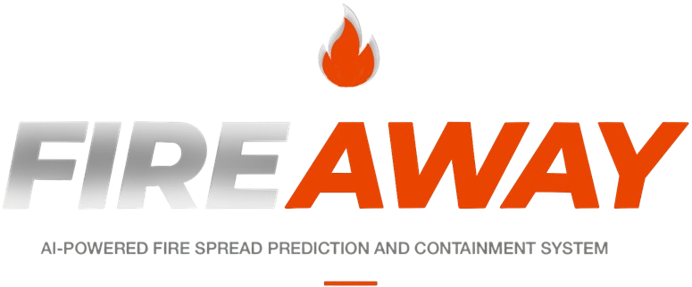

<h1 align="center">AI-Powered Fire Spread Prediction and Containment System</h1> 

    

 
  
<h2 align="center">Panic! At The Kernel in collaboration with EPI-USE Africa</h2>

  

 

  
   

  
  
 

 

## Oveview

Fire Away is an AI-powered wildfire spread prediction and containment system that helps emergency responders and the public react to fires faster. Our aim is to change fire response from reactive chaos to proactive defense, helping to keep first responders and communities safe. Fire Away combines live weather and terrain data, machine-learning models and community fire reports to simulate how a fire will grow, flag the areas at risk, and recommend where to build containment boundaries. The platform has separate experiences for guests, users, firefighters and administrators, and it works as an installable, offline-capable web app. 

## Documentation
## Demo 1
- [System Requirements Specification](docs/AI_Powered_Fire_Spread_and_Containment_System_SRS.pdf)
- [Design Specification](https://ai-powered-fire-spread-prediction-a-rho.vercel.app/brand_style)
- [GitHub Project Board](https://github.com/orgs/COS301-SE-2026/projects/50)
- [Demo 1 Video](https://drive.google.com/file/d/16Z-MCgUCJp-F70VOWNHeQ-Bj-QO6Uusz/view?usp=sharing)

## Demo 2
- [System Requirements Specification](docs/Demo\2/AI_Powered_Fire_Spread_and_Containment_System_SRS_v2.pdf)
- [Software Architecture Specification](docs/Demo\2/AI_Powered_Fire_Spread_and_Containment_System_Software_Architecture_Specifications_v1.pdf)
- [Coding Standards Document](docs/Demo\2/AI_Powered_Fire_Spread_and_Containment_System_Coding_Standards_v1.pdf)
- [Testing Policy](docs/Demo\2/AI_Powered_Fire_Spread_and_Containment_System_Testing_Policy_v1.pdf)
- [User Manual](docs/Demo\2/AI_Powered_Fire_Spread_and_Containment_System_User_Manual_v1.pdf)
- [Brand Style Guide](docs/Demo\2/Brand\Style\Guide\Demo2.pdf)
- [Demo 2 Video](https://drive.google.com/file/d/1zWEK_NMULq0Mn66kDRX5lD-8BBIXezy3/view?usp=sharing)
  
## Demo 3
- [System Requirements Specification](docs/Demo_3/AI_Powered_Fire_Spread_and_Containment_System_SRS.pdf)
- [Software Architecture Specification](docs/Demo_3/AI_Powered_Fire_Spread_and_Containment_System_Software_Architecture_Specifications.pdf)
- [Coding Standards Document](docs/Demo_3/AI_Powered_Fire_Spread_and_Containment_System_Coding_Standards.pdf)
- [Testing Policy](docs/Demo_3/AI_Powered_Fire_Spread_and_Containment_System_Testing_Policy.pdf)
- [User Manual](docs/Demo_3/AI_Powered_Fire_Spread_and_Containment_System_User_Manual.pdf)
- [Technical Installation Manual](docs/Demo_3/AI_Powered_Fire_Spread_and_Containment_System_Technical_Installation_Manual.pdf)
- [Brand Style Guide](https://fireaway.csml.co.za/brand_style)
- [Service Contract](docs/Demo_3/service_contract.yaml)
- [Demo 3 Video](https://drive.google.com/file/d/1HUqzDCWZbNxkSNpc5LPWVbNsd3dMQ__0/view?usp=sharing)

## Demo 4
- [System Requirements Specification](docs/Demo_4/AI_Powered_Fire_Spread_and_Containment_System_SRS.pdf)
- [Software Architecture Specification](docs/Demo_4/AI_Powered_Fire_Spread_and_Containment_System_Software_Architecture_Specifications.pdf)
- [Coding Standards Document](docs/Demo_4/AI_Powered_Fire_Spread_and_Containment_System_Coding_Standards.pdf)
- [Testing Policy](docs/Demo_4/AI_Powered_Fire_Spread_and_Containment_System_Testing_Policy.pdf)
- [User Manual](docs/Demo_4/AI_Powered_Fire_Spread_and_Containment_System_User_Manual.pdf)
- [Technical Installation Manual](docs/Demo_4/AI_Powered_Fire_Spread_and_Containment_System_Technical_Installation_Manual.pdf)
- [Brand Style Guide](https://fireaway.csml.co.za/brand_style)
- [Service Contract](docs/Demo_3/service_contract.yaml)
- [Demo 4 Video](https://drive.google.com/drive/folders/1fBHFX1r7PS7xMcdS3nlimVbZfzZK610T?usp=sharing)

## Meet the Team

  

<table style="border-width: 1px; width: 100%; font-family: Arial, sans-serif; border-collapse: collapse;">
<tr>
  <td style="vertical-align: top; width:auto; border: 0; padding: 10px;">
    
    </td>

  <td style="vertical-align: top; width: auto; border: 0; padding: 10px;">
    <h2><b style="font-size: 18px;">Megan Lai</b></h2>
    <h3><b style="font-size: 15px;">Team Lead, Full Stack Engineer</b></h3>
    I am a final-year student at the University of Pretoria, majoring in both Computer Science and Data Science. I am a driven problem-solver and aspiring software engineer who thrives on tackling complex technical challenges. While I possess a solid
foundation in frontend technologies, my primary expertise and professional passion lie in backend development. I am passionate about software engineering and development, cybersecurity, artificial intelligence, and machine learning. I am always looking for ways to expand my knowledge and learn new skills in order to build innovative and impactful solutions.
     
&nbsp;&nbsp; 

  </td>
</tr>

  <tr>
  <td style="vertical-align: top; width:auto; border: 0; padding: 10px;">
    
    </td>
  <td style="vertical-align: top; width: auto; border: 0; padding: 10px;">
    <h2><b style="font-size: 18px;">Ryan Lynn</b></h2>
    <h3><b style="font-size: 15px;">Full Stack Engineer</b></h3>
   I am a final-year Computer Science student with a strong focus on backend development and system design. I take a structured and analytical approach to solving complex technical problems, with a particular interest in building efficient, scalable, and well-architected systems.
     
&nbsp;&nbsp;

  </td>
</tr>

 <tr>
  <td style="vertical-align: top; width:auto; border: 0; padding: 10px;">
    
    </td>
  <td style="vertical-align: top; width: auto; border: 0; padding: 10px;">
    <h2><b style="font-size: 18px;">Inge Keyser</b></h2>
    <h3><b style="font-size: 15px;">Full Stack Engineer</b></h3>
    I am a results-oriented BSc Computer Science student at the University of Pretoria
with a strong foundation in data analysis, programming, and mathematics. I am
passionate about leveraging data-driven insights to
solve complex problems and am always looking to apply and expand my skills in Data
Science. I am quick to adapt and master new technologies, I apply creative problemsolving skills and demonstrate high enthusiasm when tackling new projects.
     
&nbsp;&nbsp;

  </td>
</tr>

 <tr>
  <td style="vertical-align: top; width:auto; border: 0; padding: 10px;">
    
    </td>
  <td style="vertical-align: top; width: auto; border: 0; padding: 10px;">
    <h2><b style="font-size: 18px;">Janri du Toit</b>
    <h3><b style="font-size: 15px;">Full Stack Engineer</b></h3>
    I am a final-year student with a growing interest and curiosity in all the facets of
Computers Science. I gravitate more towards AI and data science where algorithms
don't just solve problems, they uncover them. To me, the ability of a well-trained
model to reveal invisible patterns, optimizing system performance and offering
solutions to real-world challenges, is where logic meets true impact.
     
&nbsp;&nbsp;

  </td>
</tr>

  <tr>
  <td style="vertical-align: top; width:auto; border: 0; padding: 10px;">
    
    </td>
  <td style="vertical-align: top; width: auto; border: 0; padding: 10px;">
    <h2><b style="font-size: 18px;">Marco de Wit</b></h2>
    <h3><b style="font-size: 16px;">Full Stack Engineer</b></h3>
    I am a final-year Mathematics student with a strong foundation in software
development, specialising in C++, TypeScript, and Python. I bring a combination
of analytical thinking and practical problem-solving, allowing me to design
efficient and optimised solutions grounded in mathematical principles
     
&nbsp;&nbsp;
    
  </td>
</tr>
</table>

